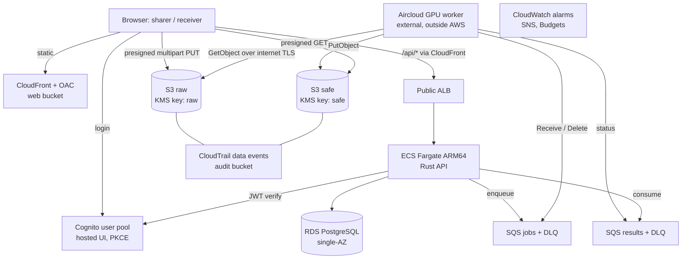

# Architecture (POC, single jurisdiction)



## Network

- VPC `10.20.0.0/16`, 2 AZs. Public subnets: ALB, NAT instance. Private subnets: Fargate
  tasks, RDS. The anonymization worker is outside the VPC (Aircloud) and uses only public
  AWS endpoints (SQS, S3, ECR, STS). No resource in a private subnet has a public IP.
- Private egress: one NAT instance (t4g.nano, AL2023 arm64, iptables MASQUERADE,
  source/dest check off). `nat_mode = "gateway"` swaps in a managed NAT Gateway.
  Single NAT = single-AZ dependency for private egress (POC tradeoff).
- S3 gateway endpoint (free) on all route tables: raw/safe traffic and ECR layer downloads
  bypass the NAT. Interface endpoints are opt-in (`interface_endpoints`).
- Security groups: ALB 80/443 from internet; tasks only from ALB SG; RDS 5432 only from the
  task SG; NAT instance accepts only VPC CIDR.

## Data isolation model

| Principal | raw bucket | safe bucket |
|---|---|---|
| API task role | presign PUT / multipart, GetObjectAttributes (no GetObject) | presign GET |
| External worker role (Aircloud) | GetObject | PutObject (under `external_gpu_safe_put_prefix`) |
| Anyone else (incl. CI ReadOnlyAccess, console users) | denied by bucket policy + no KMS use | denied by bucket policy + no KMS use |
| Receiver browser | never (only presigned PUT for sharers' uploads) | presigned GET issued after API authorization |

Enforcement is layered: (1) IAM policy on the role, (2) bucket policy `Deny` on object
data actions for any `aws:PrincipalArn` not in the allowlist, (3) KMS key policy grants
data-plane use only to the named roles (account root gets key administration only).
`break_glass_principal_arns` is the explicit escape hatch.

Presigned URLs remain valid until expiry even if the app-level grant is revoked: keep
expiry short (minutes) in the API. Immediate revocation would need a delivery gateway
(future).

## Authentication vs authorization

Cognito proves identity (JWT). Organization membership, dataset ownership, version
publication state, and the five product roles live in PostgreSQL and are checked by the
API on every request and before issuing any presigned URL. Cognito groups are deliberately
not used: they are pool-global and cannot express org- or dataset-scoped permissions.

## External GPU (Aircloud)

The worker lifecycle (start/stop, GPU hours) is managed on Aircloud, not by AWS. AWS side:
IAM user (assume-role only, ExternalId, optional source-IP restriction) -> 1 h role
sessions -> jobs queue (consume), results queue (send), raw (get), safe (put), ECR pull.
Message contract, idempotency and heartbeat rules: [gpu-adapter.md](gpu-adapter.md).

**Jurisdiction: met.** Aircloud runs in a Korean region (source: user confirmation
2026-11-09), so anonymization stays in the sharer's jurisdiction. Raw bytes leave AWS over
the internet (TLS) but stay in Korea.

## Cross-border expansion: one environment directory per jurisdiction

Every module is region-parameterised; nothing hardcodes `ap-northeast-2` except defaults.
A new jurisdiction is a new root, not a new code path:

```
environments/
  poc/            # KR, ap-northeast-2  (raw + safe in KR; GPU on Aircloud KR region, user-confirmed 2026-11-09)
  jp-poc/         # JP, ap-northeast-1  (own state key, own buckets/keys/queues/worker role)
```

- Each jurisdiction gets its own state key, raw/safe buckets, KMS keys, queues and
  external-worker role. Raw data stays in-region on AWS by construction; anonymization stays
  in-jurisdiction only if the external GPU provider has capacity in that jurisdiction.
- Shared, non-data concerns (identity, the control-plane DB holding orgs and grants) need a
  product decision: one global control plane (stores metadata only, never video) or one
  per jurisdiction. Delivery of approved derivatives to another jurisdiction should be an
  explicit, separately authorized copy job, not cross-region replication.
- Prefer separate AWS accounts per jurisdiction once beyond POC (blast radius, SCP-enforced
  region restriction, per-jurisdiction billing).
